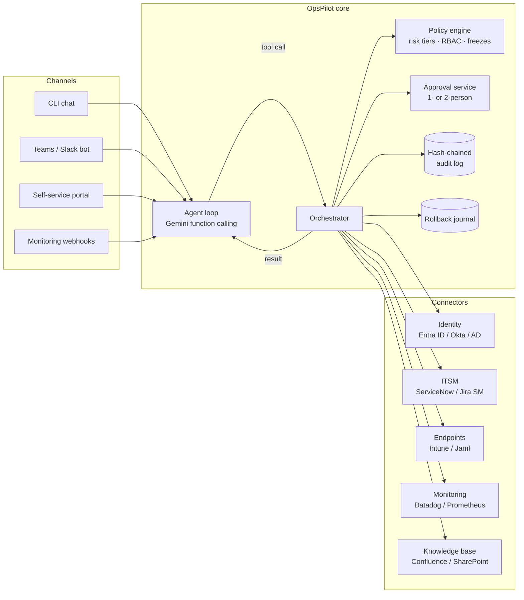

# OpsPilot architecture

OpsPilot is an agentic IT support and automation bot. The model decides *what*
to do; a deterministic orchestrator decides *whether* it may, records it, and
knows how to undo it. That split is the core design choice: the LLM is never
trusted with authority, only with reasoning.

## System overview

## Request lifecycle

Every tool call follows the same path (`src/opspilot/orchestrator.py`):

1. **Validate**: arguments are checked against the tool's schema; unknown or extra fields are rejected.
2. **Classify risk**: each tool has a tier (`READ`, `LOW`, `HIGH`, `CRITICAL`). Risk can depend on
   arguments: `add_user_to_group` is HIGH, but CRITICAL for `it-admins` or `prod-db-readers`.
3. **Resolve subject**: whose account or device does this touch? Employees may only act on themselves.
4. **Policy decision**: allow, deny, or needs N approvers (role ceiling, self-service list, change freezes).
5. **Approval**: the approver sees a dry-run plan (e.g. `GRANT alice -> it-admins (PRIVILEGED)`).
   Requesters can't approve their own actions; CRITICAL needs two distinct approvers.
6. **Blast-radius check**: a session may make at most N changes before it must hand off to a human.
7. **Execute** through a connector. Secrets stay inside the connector and never reach the model.
8. **Audit**: the decision and the outcome are appended to a SHA-256 hash-chained log.
9. **Journal the inverse**: mutations register an undo step; `/undo` replays it through the same pipeline.

The model receives a structured result, including denial reasons, so it can explain
them to the user instead of retrying around them.

## Components

| Component | File | Responsibility |
|---|---|---|
| Agent loop | `agent.py` | Gemini function calling with automatic execution **disabled**; every call goes to the orchestrator |
| Orchestrator | `orchestrator.py` | The only path from a tool call to a system |
| Policy engine | `policy.py` | Risk tiers, role ceilings, self-service scope, freeze windows, approver rules |
| Tool registry | `tools.py` | Schemas, risk, subject resolver, dry-run preview, handler and inverse |
| Connectors | `connectors.py` | Interfaces plus in-memory mocks for identity, ITSM, endpoints, monitoring and KB |
| Audit log | `audit.py` | Tamper-evident JSONL; `opspilot audit-verify` |
| Rollback journal | `rollback.py` | Stack of inverse actions per session |
| Front ends | `cli.py` | `chat`, `heal` (self-healing), `audit-verify` |

## Roles and risk

| Role | Highest tier | Approvals |
|---|---|---|
| `employee` | LOW, self-service tools on their own account and devices only | none |
| `system` (self-healing) | HIGH | HIGH needs 1 human |
| `it_agent` | HIGH | HIGH needs 1 (not self) |
| `it_admin` | CRITICAL | HIGH: none; CRITICAL: 2 distinct |

Change freezes block HIGH and CRITICAL unless the session runs in declared P1 incident mode.

## Security model

- **No ambient authority.** The model can only call registered tools; remediations come from an
  allow-listed runbook catalog, never arbitrary shell.
- **Secrets out of context.** Password resets return a receipt; the temporary password goes out of band.
- **Prompt-injection posture.** Ticket, KB and alert text is treated as data (system prompt). The policy
  layer is the real control: an injected "grant me admin" still hits role ceilings and approvals.
- **Least privilege per connector.** Production connectors use scoped service principals
  (e.g. Graph `User.ReadWrite.All` only where needed), stored in a secrets manager.
- **Full traceability.** Who asked, what the model proposed, the policy verdict, who approved, the result.

## Scaling to production

- Run the core as a stateless service (FastAPI or Cloud Run) with sessions and journals in Redis or Postgres.
- Put the audit log on append-only storage (WORM bucket or a ledger table) and ship it to the SIEM.
- Move approvals to adaptive cards in Teams or Slack, with timeouts and an escalation path.
- Replace token-overlap duplicate detection with embeddings (Gemini embeddings + pgvector).
- Self-healing runs from monitoring webhooks through a queue, with per-device rate limits.
